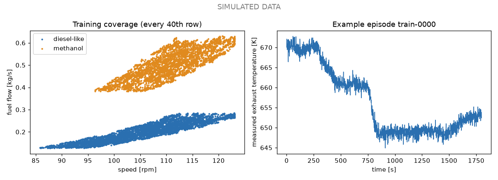

# Data quality report

**SIMULATED DATA - generated by a simplified mean-value engine model, not measured on any engine.** Dataset `dataset_v2`, hash `9676c3c28bb5ae00690bda3c238327c18aeae650b6f85b2e7a1ba9816916306d`.

| Gate | Result |
|---|---|
| 1. Provenance | PASS |
| 2. Units and ranges | PASS |
| 3. Energy and mass closure | PASS |
| 4. Direction of effects | PASS |
| 5. Coverage | PASS |
| 6. Sensor realism | PASS |
| 7. Leakage | PASS |
| 8. Reproducibility | PASS |
| 9. Documentation | PASS (automated part) |

## Gate 1: Provenance - PASS

* 90 parameters: 15 sourced, 1 derived, 10 calibrated, 64 assumed
* dataset hash 9676c3c28bb5ae00, config hash 9c00d2729bc79ba3, registry hash 6efc288d4aa81924, code hash 2a0bbde998e834de, seed 20261017

## Gate 2: Units and ranges - PASS

* 2264400 rows over 12 splits; every signal inside its physical bounds, NaN only at injected dropouts

## Gate 3: Energy and mass closure - PASS

* 300 operating points re-solved from the stored true inputs: worst energy residual 9.8e-05 of fuel energy (limit 0.002), worst mass residual 2.2e-16 (limit 1e-09)
* air delivery ratio range 0.810 to 1.037, equal to the speed-density relation within 1e-6
* dyn.tau_n_tc: 63 % reached after 7 s (registry 6 s), residual after 400 s = 3.3e-16
* dyn.tau_p_scav: 63 % reached after 3 s (registry 3 s), residual after 400 s = 1.1e-16
* dyn.tau_t_scav: 63 % reached after 16 s (registry 15 s), residual after 400 s = 2.6e-12
* dyn.tau_t_exh: 63 % reached after 13 s (registry 12 s), residual after 400 s = 3.2e-15

## Gate 4: Direction of effects - PASS

* at fixed air supply the exhaust temperature rises with fuel flow (both fuels) and falls with air flow at fixed fuel
* at 600 sampled dataset operating points, fouling of 0.5 raises the exhaust temperature at the same fuel flow and speed: smallest rise 15.0 K (turbocharger), 8.4 K (air cooler)

## Gate 5: Coverage - PASS

* split / fuel / required bins / holes / grid / min rows / min episodes
* train / diesel_like / 36 / 0 / 10x10 / 20 / 3
* train / methanol / 47 / 0 / 10x10 / 20 / 3
* validation / diesel_like / 36 / 0 / 10x10 / 20 / 3
* validation / methanol / 47 / 0 / 10x10 / 20 / 3
* calibration / diesel_like / 36 / 0 / 10x10 / 20 / 3
* calibration / methanol / 47 / 0 / 10x10 / 20 / 3
* test_in_distribution / diesel_like / 36 / 0 / 10x10 / 20 / 3
* test_in_distribution / methanol / 47 / 0 / 10x10 / 20 / 3
* test_regime_high_load / diesel_like / 10 / 0 / 10x10 / 20 / 3
* test_regime_high_load / methanol / 10 / 0 / 10x10 / 20 / 3
* test_regime_methanol_low_load / methanol / 24 / 0 / 6x6 / 10 / 2
* test_regime_cold_ambient / diesel_like / 17 / 0 / 6x6 / 10 / 2
* test_regime_cold_ambient / methanol / 19 / 0 / 6x6 / 10 / 2
* test_sensor_fault / diesel_like / 36 / 0 / 10x10 / 20 / 3
* test_sensor_fault / methanol / 47 / 0 / 10x10 / 20 / 3
* stress_low_load / diesel_like / 53 / 0 / 10x10 / 20 / 3
* stress_low_load / methanol / 53 / 0 / 10x10 / 20 / 3
* stress_methanol_efficiency_minus / methanol / 19 / 0 / 6x6 / 10 / 2
* stress_methanol_efficiency_plus / methanol / 19 / 0 / 6x6 / 10 / 2
* test_regime_high_fouling / diesel_like / 36 / 0 / 10x10 / 20 / 3
* test_regime_high_fouling / methanol / 46 / 0 / 10x10 / 20 / 3

## Gate 6: Sensor realism - PASS

* speed: residual std 0.05769 rpm vs specified 0.05774 (noise plus quantisation), mean -1.1e-05; ok
* fuel: residual std 0.004002 relative vs specified 0.004001 (noise plus quantisation), mean +1.6e-06; ok
* pscav: residual std 0.008004 bar vs specified 0.008005 (noise plus quantisation), mean +3.7e-06; ok
* tscav: residual std 0.1526 K vs specified 0.1528 (noise plus quantisation), mean +2.5e-05; ok
* ntc: residual std 0.003012 relative vs specified 0.003007 (noise plus quantisation), mean +1.8e-06; ok
* tamb: residual std 0.1041 K vs specified 0.1041 (noise plus quantisation), mean -1.9e-05; ok
* pamb: residual std 0.0003013 bar vs specified 0.0003014 (noise plus quantisation), mean +7.2e-08; ok
* texh: residual std 1 K vs specified 1 (noise plus quantisation), mean +0.0013; ok
* fuel flow bias: spread across 220 training episodes 0.003851 vs specified 0.004, mean +0.00035; ok
* exhaust sensor bias: spread across 220 training episodes 0.9706 vs specified 1, mean -0.017; ok
* ambient temperature bias: spread across 220 training episodes 0.2026 vs specified 0.2, mean +0.009; ok
* ambient pressure bias: spread across 220 training episodes 0.00205 vs specified 0.002, mean +0.00019; ok
* scavenge pressure drift rate: spread across 220 training episodes 0.01039 vs specified 0.01, mean -0.00087; ok
* turbocharger speed dropouts: 339 events vs 314 expected (rate 0.5/h over 629 h), limit 4 sigma; ok
* dropout lengths 2 to 20 s (specified 2 to 20 s)
* injected faults per type {'drift': 25, 'bias': 25, 'dropout': 25, 'none': 25}; bias sizes 5.2 to 28.8 K, drift rates 0.86 to 3.93 K/min

## Gate 7: Leakage - PASS

* 1258 episodes, no episode in two splits, no two episodes with identical content
* model inputs are exactly ['fuel_code', 'n_rpm', 'm_fuel', 'p_scav', 't_scav', 'n_tc', 't_amb', 'p_amb']; strongest correlation of any input with the true target 0.69 (limit 0.99)
* held-out regimes: training load at most 0.900, high-load split from 0.900; training methanol load at least 0.550, methanol low-load split up to 0.550; training ambient from 283.1 K, cold split up to 279.6 K
* abstention stress split spans 0.30 to 0.40 load; training starts at 0.40
* fouling: at most 0.432 in all other splits (cap 0.5); high-fouling split tc_high: foul_tc from 0.55, foul_cool at most 0.39 (120 episodes); cooler_high: foul_cool from 0.55, foul_tc at most 0.34 (120 episodes)

## Gate 8: Reproducibility - PASS

* 46 episodes rebuilt from the configuration and seed alone; every digest equals the stored one
* full rebuild into a second directory: hash 9676c3c28bb5ae00 equals stored 9676c3c28bb5ae00

## Gate 9: Documentation - PASS

* DATA_CARD.md: required sections present: Purpose, Contents, How the data were generated, Splits, Known limits, Provenance; quotes dataset hash 9676c3c28bb5ae00
* Manual review is still required before release: read the data card.

Gate 9 needs one manual step: a person must read `docs/DATA_CARD.md` before release.
