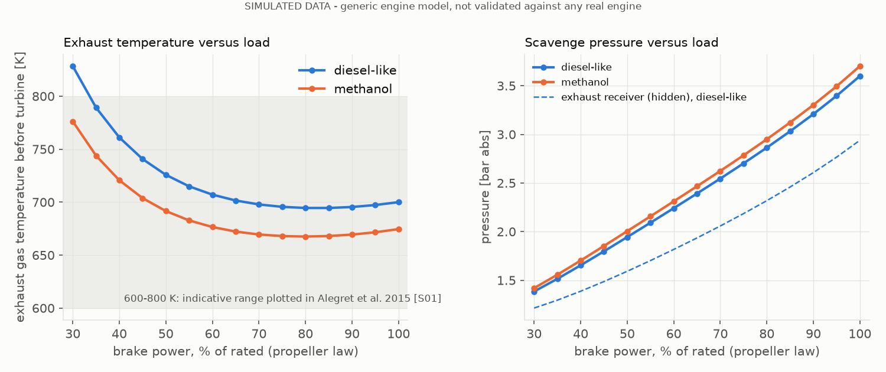
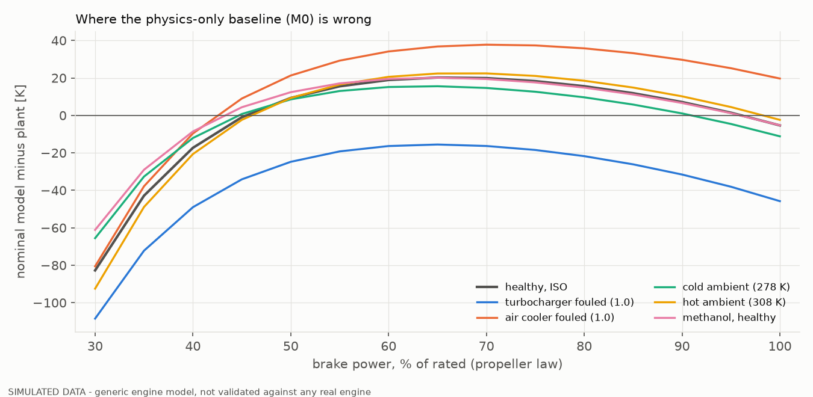

# Simulator report

**SIMULATED DATA - generic engine model, not validated against any real engine.** Generated by `scripts/simulator_report.py`; every number is computed there. Registry hash `7cbe44d3df36cbc2`.

## Gate

| Criterion | Result | Evidence |
|---|---|---|
| Exhaust temperature in a plausible band across load | PASS from 40 % load | 600-800 K [S01, indicative]. Diesel-like: 694-761 K for 40-100 % load. Methanol: 668-721 K. **Outside the band: loads 30 % (diesel-like 828 K); no source covers that region.** |
| Scavenge pressure rises with load | PASS | diesel-like 1.38 -> 3.60 bar, methanol 1.42 -> 3.70 bar, strictly increasing |
| Unit tests pass | PASS | ============================= 85 passed in 25.78s ============================= |
| Cantera mechanism check | PASS | docs/CANTERA_CHECK.md |
| Every parameter has a source or is marked assumed | PASS | 46 parameters: 20 assumed, 10 calibrated, 1 derived, 15 sourced |

## Load sweep on the propeller law (healthy, ISO ambient)

Exhaust temperature and scavenge pressure are the model's *predictions*: only the rated point (and, for efficiency, the 50/75/100 % fuel-consumption points) were calibrated.

| load % | speed rpm | fuel kg/s | p_scav bar | T_scav K | n_tc rpm | T_exh K | air kg/s | excess air | SFOC g/kWh | p_exh/p_scav (hidden) |
|---|---|---|---|---|---|---|---|---|---|---|
| 30 | 82.3 | 0.099 | 1.38 | 300.8 | 7599 | 828 | 3.0 | 2.04 | 173.1 | 0.877 |
| 35 | 86.7 | 0.114 | 1.51 | 301.6 | 8644 | 789 | 3.8 | 2.21 | 170.5 | 0.855 |
| 40 | 90.6 | 0.128 | 1.65 | 302.3 | 9576 | 761 | 4.5 | 2.35 | 168.4 | 0.839 |
| 45 | 94.3 | 0.143 | 1.80 | 303.1 | 10403 | 741 | 5.3 | 2.47 | 166.8 | 0.827 |
| 50 | 97.6 | 0.158 | 1.94 | 303.8 | 11141 | 726 | 6.0 | 2.56 | 165.5 | 0.819 |
| 55 | 100.8 | 0.172 | 2.09 | 304.5 | 11804 | 715 | 6.8 | 2.63 | 164.5 | 0.814 |
| 60 | 103.7 | 0.187 | 2.24 | 305.2 | 12407 | 707 | 7.5 | 2.69 | 163.8 | 0.811 |
| 65 | 106.5 | 0.202 | 2.39 | 305.8 | 12961 | 702 | 8.3 | 2.73 | 163.3 | 0.809 |
| 70 | 109.2 | 0.217 | 2.55 | 306.5 | 13478 | 698 | 9.0 | 2.77 | 163.0 | 0.809 |
| 75 | 111.8 | 0.233 | 2.70 | 307.1 | 13965 | 696 | 9.8 | 2.80 | 163.0 | 0.809 |
| 80 | 114.2 | 0.249 | 2.86 | 307.7 | 14430 | 695 | 10.6 | 2.83 | 163.2 | 0.810 |
| 85 | 116.5 | 0.265 | 3.03 | 308.3 | 14880 | 694 | 11.3 | 2.85 | 163.7 | 0.811 |
| 90 | 118.8 | 0.282 | 3.21 | 308.9 | 15321 | 695 | 12.2 | 2.87 | 164.5 | 0.813 |
| 95 | 120.9 | 0.299 | 3.40 | 309.5 | 15758 | 697 | 13.0 | 2.90 | 165.5 | 0.814 |
| 100 | 123.0 | 0.318 | 3.60 | 310.1 | 16200 | 700 | 13.9 | 2.92 | 167.0 | 0.816 |

## Consistency checks against sources

* Implied rated brake mean effective pressure: **20.0 bar** (assumed stroke 2.2 m). The larger G60ME-C9.5 quotes 21.0 bar at L1 [S10]: same class, different engine, so this supports only the order of magnitude.
* Fuel consumption at 50/75/100 % load: 165.5 / 163.0 / 167.0 g/kWh. Published (G60ME-C9.5, high-load tuning): 165.5 / 163.0 / 167.0 [S10]. This was a calibration, so the match proves nothing; the curve outside 50-100 % load is an extrapolation (173 g/kWh at 30 %).
* Rated point: T_exh 700.0 K, p_scav 3.60 bar, n_tc 16200 rpm (1696 rad/s), scavenge air 12.0 K above cooling water [S08: about 12 K by design], air flow 13.9 kg/s, excess air ratio 2.92. T_exh, p_scav and n_tc are calibration targets chosen inside the S01 plot ranges; air flow and excess air are NOT calibrated and have no source.
* Low-load scavenge air only 2.6 K above cooling water at 30 % load, consistent in direction with S08 ("only slightly higher").

## Size of each effect on the target (diesel-like unless stated)

Change in exhaust temperature, scavenge pressure, scavenge temperature and turbocharger speed against the healthy ISO case at the same fuel flow and speed.

**turbocharger fouled (1.0)**

| load | dT_exh K | dp_scav bar | dT_scav K | dn_tc rpm |
|---|---|---|---|---|
| 30 % | +23.3 | +0.010 | +0.2 | +286 |
| 50 % | +39.9 | -0.027 | +0.2 | +150 |
| 75 % | +49.5 | -0.089 | +0.1 | +76 |
| 100 % | +55.8 | -0.149 | +0.1 | +81 |

**air cooler fouled (1.0)**

| load | dT_exh K | dp_scav bar | dT_scav K | dn_tc rpm |
|---|---|---|---|---|
| 30 % | +15.6 | -0.001 | +8.1 | +16 |
| 50 % | +20.4 | +0.029 | +18.0 | +171 |
| 75 % | +24.5 | +0.117 | +29.1 | +383 |
| 100 % | +29.0 | +0.253 | +39.9 | +559 |

**cold ambient (278 K)**

| load | dT_exh K | dp_scav bar | dT_scav K | dn_tc rpm |
|---|---|---|---|---|
| 30 % | -73.3 | +0.045 | -19.9 | +114 |
| 50 % | -56.7 | +0.076 | -20.0 | -40 |
| 75 % | -49.0 | +0.097 | -20.3 | -203 |
| 100 % | -46.3 | +0.117 | -20.5 | -320 |

**hot ambient (308 K)**

| load | dT_exh K | dp_scav bar | dT_scav K | dn_tc rpm |
|---|---|---|---|---|
| 30 % | +37.6 | -0.021 | +10.0 | -63 |
| 50 % | +28.9 | -0.036 | +10.0 | +8 |
| 75 % | +24.7 | -0.046 | +10.1 | +89 |
| 100 % | +23.2 | -0.056 | +10.2 | +149 |

**methanol versus diesel-like at equal brake power** (composition and turbocharger feedback together)

| load | dT_exh K | dp_scav bar | fuel mass ratio |
|---|---|---|---|
| 30 % | -52.1 | +0.034 | 2.21 |
| 50 % | -34.2 | +0.061 | 2.21 |
| 75 % | -27.6 | +0.082 | 2.21 |
| 100 % | -25.4 | +0.102 | 2.21 |

Direction checks (tests): fouling of either kind raises exhaust temperature; colder ambient lowers it, consistent with MAN's statement that the temperature after the turbine drops in winter [S08]. **The sizes are not verified**: S08 gives no numbers. Cooler fouling *raises* scavenge pressure in this model (a hotter exhaust drives the turbocharger harder); I could not confirm that sign against a source. Turbocharger fouling lowers boost from 50 % load up but not at 30 %.

## How wrong is the physics-only baseline (M0)?

Fit on the healthy ISO diesel-like grid (45 points, load 30-100 % at three speed offsets from the propeller law): RMSE 29.1 K overall; 17.7 K for loads of 45 % and above; 50.0 K below 45 % (max 86 K).

| scenario | RMSE K, 40-100 % load | bias K, 40-100 % | RMSE K, 30-35 % |
|---|---|---|---|
| healthy, ISO | 14.1 | +8.8 | 65.9 |
| turbocharger fouled (1.0) | 29.6 | -27.5 | 92.2 |
| air cooler fouled (1.0) | 29.2 | +26.1 | 62.9 |
| cold ambient (278 K) | 10.8 | +5.3 | 51.8 |
| hot ambient (308 K) | 16.1 | +10.4 | 74.0 |
| methanol, healthy | 13.7 | +10.0 | 47.9 |

## Limitations found (also in `docs/MODEL_CHOICES.md`)

1. **Below about 40 % load the model is unverified and runs hot** (see gate row). Real engines use auxiliary blowers at low load; this model has none.
2. **Exhaust temperature is nearly flat between 50 and 100 % load** (694-726 K) because the matched turbocharger raises air flow almost in proportion to fuel. I could not find part-load exhaust data to check this against. If real engines show a steeper curve, the plant is too forgiving.
3. **Air flow responds strongly to exhaust back-pressure** through the assumed square-root delivery law; its sensitivity is an assumption, not a result.
4. **Cold or hot ambient is not a hard regime shift here**: the nominal model absorbs it through the measured scavenge pressure and temperature (table above). The design lists cold ambient as a held-out regime.
5. **The fuel effect is large (see table) and comes only from exhaust composition and turbocharger feedback**; both fuels share the same efficiency curve, which is an assumption.
6. Compressor and turbine run at constant efficiency with no maps; the stroke, friction, wall-loss share and fouling magnitudes are assumptions (see `docs/PARAMETERS.md`).
